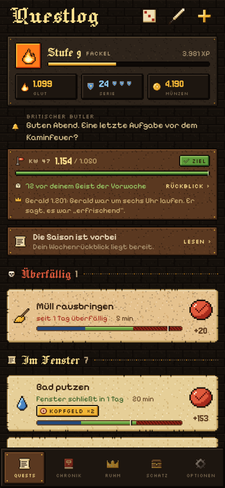
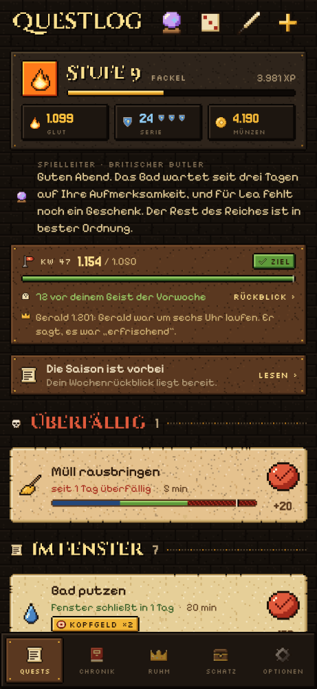
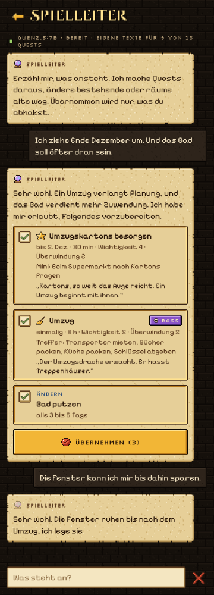
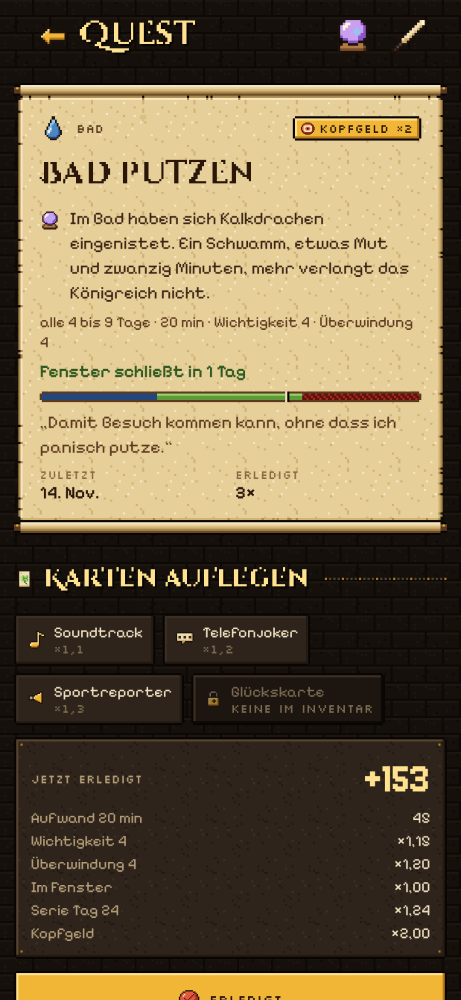
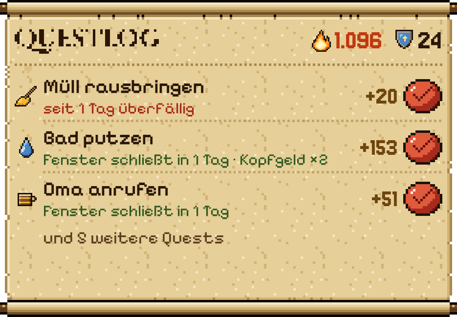
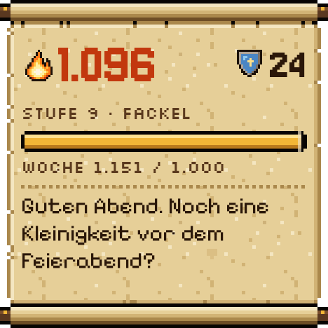

# Questlog

Gamifizierte To-do-Liste für Android im Look eines 90er-Fantasy-Rollenspiels: Pergament-Schriftrollen, Kerkerstein, Pixel-Überschriften. Aufgaben sind Quests mit Zeitfenster, bringen Punkte nach selbst gesetzten Regeln, füllen Lebens-XP und Glut, und landen in Rekorden, Meilensteinen und einer Wochen-Saison.

Die App läuft komplett ohne KI, offline und ohne Konto. Als Bonus lässt sie sich mit einer eigenen KI verbinden (z. B. Ollama auf der AI-Box oder ein Cloud-Dienst): Dann baut ein **KI-Spielleiter** im Gespräch Quests und schreibt Texte, die genau zu den eigenen Aufgaben passen. Details in `DESIGN.md`.

## Was drin ist

- **Quests mit Zeitfenster:** Frühestens nach X Tagen, spätestens nach Y Tagen. Zu früh bringt ×0,25, im Fenster alles, überfällig −10 % pro Tag. Einmalige Quests mit optionalem Termin.
- **Punkte mit Beipackzettel:** Aufwand (Wurzel aus Minuten), Wichtigkeit, Überwindung, Timing, Serie, Combo, Kopfgeld, Karten. Nach jeder Quest steht genau da, wie die Zahl entsteht.
- **Zwei Konten:** Lebens-XP sinken nie (Level, Ränge, Meilensteine). Die Glut ist die aktuelle Form: −15 % pro Tag, Quests legen nach, überfällige Quests ziehen ab, nie unter 10 % der Bestform.
- **Dranbleiben:** Serien mit Schonfrist (erst der zweite freie Tag bricht sie) und Schutzschilden, Mini-Versionen, Comeback ×2, Pause-Modus, Wochen-Saison mit Ziel und Geist der Vorwoche, Wochenrückblick.
- **Würze:** Bosse mit Teilaufgaben und Zorn, Speedrun-Bestzeiten, Beute, Belohnungs-Shop mit echten Belohnungen, Quest-Roulette, Kopfgeld des Tages, verstaubende Karten.
- **Modifier-Karten** (über Level freigeschaltet): Soundtrack, Telefonjoker, Handy weg, Drei-Song-Challenge, Blind Date, Doppelt oder nichts, Hardcore-Woche, Sportreporter, Tanzpause mit Bewegungssensor.
- **Chaos-Kammer** (alles einzeln schaltbar, standardmäßig aus): Comic-Sans-Fluch, Erzähler-Stimmen, Nemesis Gerald, Faulheitssteuer-Bescheid, Wollmäuse, Quest-Hochzeiten, Heldensaga, Abspann nach Bossen, absurde Feiertage, Kampfschrei-Abhaken.
- **KI-Spielleiter (optional):** Agent, der aus Erzähltem Quests baut, ändert oder archiviert (nur mit Häkchen), Questtexte und Siegeszeilen je Quest, Tagesbriefing, Heldensaga aus den echten Wochenzahlen. Spricht jede OpenAI-kompatible Schnittstelle, Texte entstehen im Hintergrund, ohne Server gelten Vorlagen.
- **Widgets als Schriftrollen:** Questrolle mit den dringendsten Quests (abhaken mit dem Wachssiegel) und Glutrolle mit Glut, Serie, Stufe, Wochenziel und einem Wort vom Spielleiter. Im selben Pixel-Look wie die App.
- **Alltag:** Schnelleingabe aus Freitext, Vorlagen-Pakete, Erinnerungen mit Ruhezeit und Tageslimit, Abhaken aus der Benachrichtigung und per Widget, Nachtragen und Rückgängig, Statistik mit Heatmap, Backup als Datei.

Die Feature-Liste stammt aus dem Brainstorming (50 Ideen in fünf Absurditätsstufen). Was davon umgesetzt ist und was noch kommt, steht in `DESIGN.md`.

## Aufbau

- `android/` – das App-Projekt (Kotlin, Jetpack Compose). Bauen, testen, veröffentlichen: `android/README.md`.
- `DESIGN.md` – Spielregeln mit allen Zahlen, Look, Psychologie dahinter, KI-Spielleiter und Play-Store-Checkliste.

| Board mit Tagesbriefing | Gespräch mit dem Spielleiter | Quest mit eigenem Text |
|---|---|---|
|  |  |  |

| Questrolle | Glutrolle |
|---|---|
|  |  |
